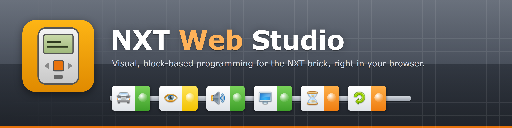
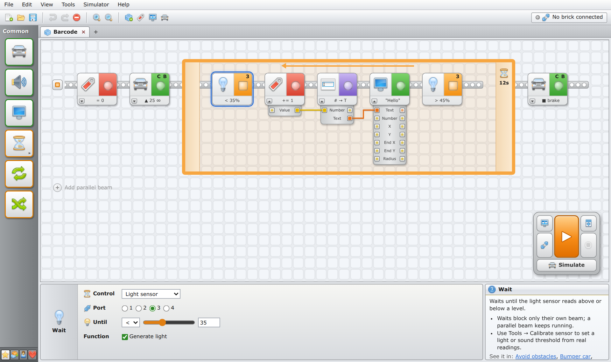
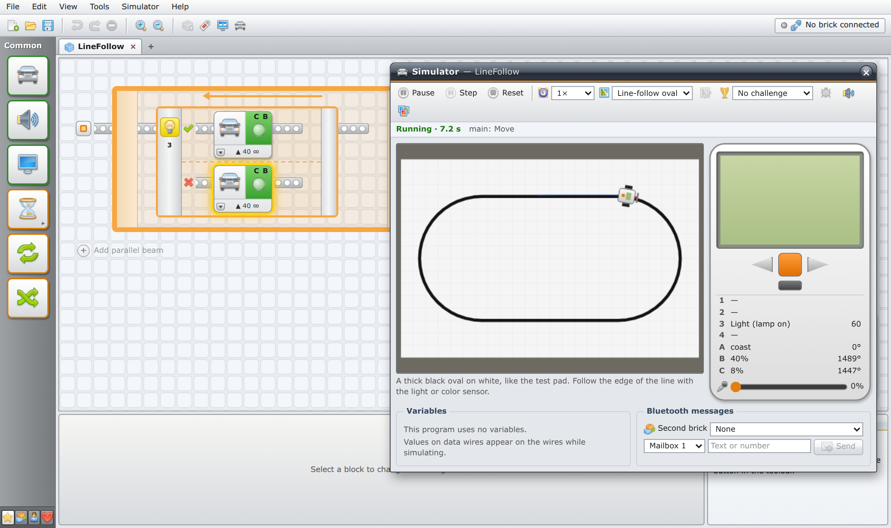
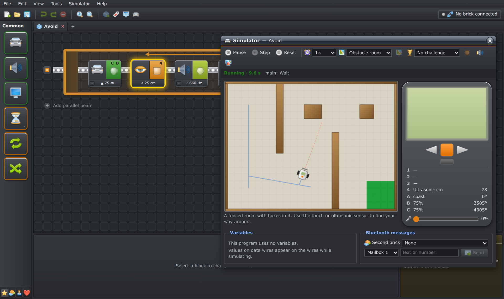
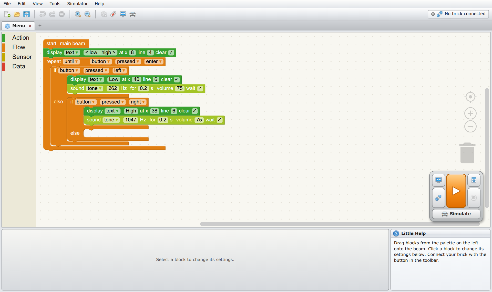
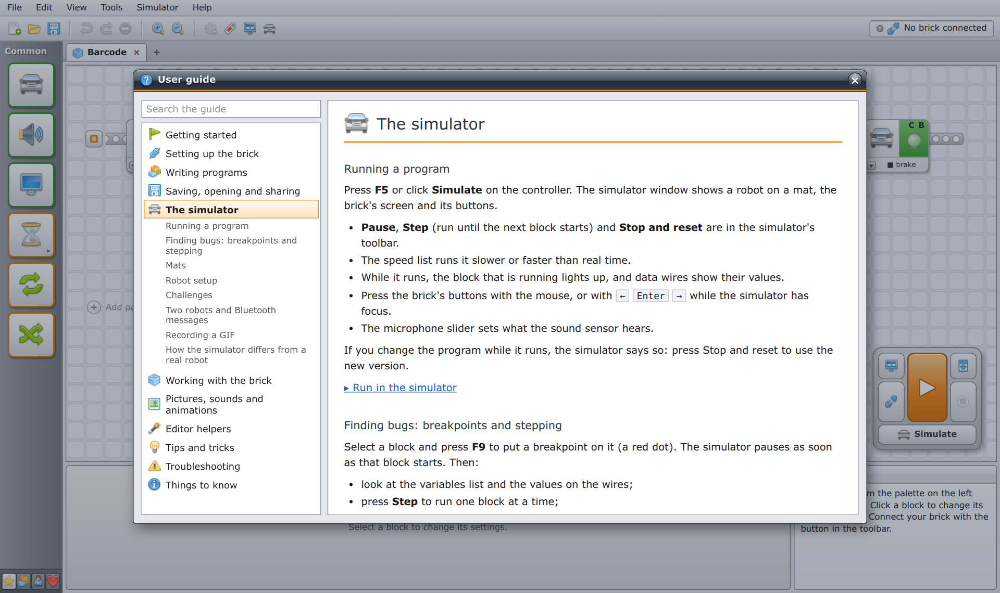

<p align="center">
  
</p>

# NXT Web Studio

Visual, block-based programming for the NXT brick, running entirely in your browser.
Drag blocks, click Run, and the robot moves. No install and no server.

> Independent project, not affiliated with the LEGO Group. See [NOTICE](NOTICE).



<table>
  <tr>
    <td width="50%"></td>
    <td width="50%"></td>
  </tr>
  <tr>
    <td align="center">Simulator: run a program on a virtual robot</td>
    <td align="center">Dark theme and the obstacle room</td>
  </tr>
  <tr>
    <td width="50%"></td>
    <td width="50%"></td>
  </tr>
  <tr>
    <td align="center">Modern blocks view</td>
    <td align="center">Built-in user guide (F1)</td>
  </tr>
</table>

**Status:** the editor, simulator, brick connection and compiler work; the compiler still
needs its first run on a real brick (Phase 3 in the hardware checklist).
See [PLAN.md](PLAN.md) for the roadmap and [docs/hardware-tests.md](docs/hardware-tests.md)
for what to test on a real brick.

The editor follows the classic NXT 2.0 software: a sequence beam with blocks, loops and
switches, fold-out data hubs with wires, parallel beams, a configuration panel and a
controller. Try `?example=distance` or `?example=parallel` in the URL.

**Simulator:** press F5 (or **Simulate**) to run the program on a virtual robot: pick a mat
(line-follow oval, obstacle room, color race and more), watch the brick's screen, press its
buttons, and hear its tones. Running blocks light up and data wires show their values; set
breakpoints with F9 and step block by block.

Draw your own mats (or use a photo of a real one), play **challenges** with a timer and
stars, tell the simulator how your robot is built (Tools → Robot setup), and put a second
brick on the mat that talks to the first over simulated Bluetooth.

**Editor helpers:** several programs open in tabs, a command palette (Ctrl+K), a program
checker with tips, Tidy up, favourite blocks, a distance and turn calculator, snippets, a
program library that keeps your work in the browser, share links, export as PNG/SVG, guided
tutorials, a built-in user guide (F1), block help with examples, an example gallery, a dark theme, a Blockly-style
"modern blocks" view, and touch support for tablets.

**Brick tools:** files (with multi-delete and a cleanup of unused pictures and sounds), a
live sensor monitor, data logging, a live copy of the brick's screen (record
it as a GIF), a low-battery warning, a sound recorder (microphone → .rso), a picture editor (.ric) and an
animated-GIF converter that also builds the program to play it.

**Remote control with your own controls:** drive the brick or the simulated robot with
keys, key combinations or a gamepad. Choose how it steers (two wheels, tank tracks, or a
car with a steering motor that never turns past its ends), set limits, names and top
power per motor, bind keys to motors or to sequences of commands, and save the setups
as profiles you can export and share.

**Download:** programs compile to `.rxe` files for the stock firmware and upload over USB
(or Bluetooth, experimental). Without a brick you can save the `.rxe` file.

**Works offline:** once loaded, the app can be installed and runs without a network.

**Opens original NXT-G programs:** File → Open accepts `.rbt`
files from the NXT 2.0 software. See [docs/rbt-compat.md](docs/rbt-compat.md).

## Requirements

- Chrome, Edge, Brave or Opera (current version) on Linux or macOS. Firefox and Safari lack WebUSB.
- On Linux, a udev rule so the browser can open the brick: download it from Help → Linux USB
  setup in the app, or see [docs/udev/](docs/udev/).

## Development

Requires Node 22+ and pnpm.

```sh
pnpm install
pnpm dev        # start the app at http://localhost:5173
pnpm check      # lint, format check, typecheck, test, build
```

| Command                  | What it does                                                                |
| ------------------------ | --------------------------------------------------------------------------- |
| `pnpm dev`               | Vite dev server for `apps/web`                                              |
| `pnpm test`              | Vitest in every package                                                     |
| `pnpm typecheck`         | `tsc --noEmit` in every package                                             |
| `pnpm lint`              | ESLint across the repo                                                      |
| `pnpm format`            | Prettier, writes changes                                                    |
| `pnpm build`             | Production build to `apps/web/dist`                                         |
| `pnpm fetch:nxtprograms` | Download sample .rbt programs for local compatibility tests (not committed) |

See [docs/architecture.md](docs/architecture.md) for how the code is organised.

## Licence

[MIT](LICENSE). Icons: [FatCow Farm-Fresh](http://www.fatcow.com/free-icons) (CC BY 3.0).
